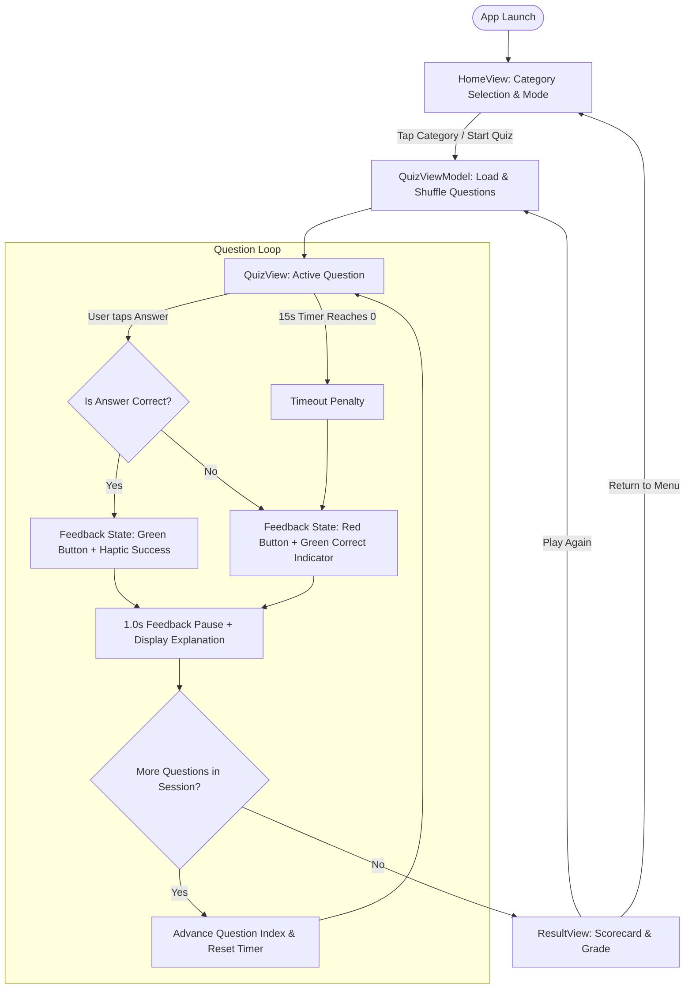

# Wireframes, Screen Layouts & User Interaction Flows

## 1. Global User Interaction Flow

The interaction architecture is intentionally linear and frictionless. From initial app launch to quiz completion, the user can start a learning session with a single tap.



---

## 2. Screen Wireframes (ASCII / Markdown Layout)

### 2.1. Screen 1: HomeView (Menu & Category Selector)

```text
+-----------------------------------------------------------+
|                      TRAIN-YOUR-BRAIN                     |
|                   Software Engineering Quiz               |
|                                                           |
|  [ Category Carousel / Selector ]                         |
|  +---------------------+   +---------------------+        |
|  | [gear] All Domains  |   | [swift] Swift/Apple |        |
|  | 24 Questions Total  |   | 6 Questions Active  |        |
|  +---------------------+   +---------------------+        |
|  +---------------------+   +---------------------+        |
|  | [network] Algorith. |   | [shield] Testing/QA |        |
|  | 6 Questions Active  |   | 6 Questions Active  |        |
|  +---------------------+   +---------------------+        |
|                                                           |
|  [ Card: Best Performance Record ]                        |
|  +-----------------------------------------------------+  |
|  | High Score: 2,450 pts  •  Accuracy: 92% (Sehr Gut)  |  |
|  +-----------------------------------------------------+  |
|                                                           |
|  [   === START QUIZ CHALLENGE ===   ]  (56pt Primary)     |
+-----------------------------------------------------------+
```

### 2.2. Screen 2: QuizView (Active Question & Countdown)

```text
+-----------------------------------------------------------+
|  [ < Quit ]      Software Engineering       [ Streak: 3x ]|
|  Question 3 of 10                       Score: 450 pts    |
|                                                           |
|  [===========================---------]  (TimerBar: 11.2s)|
|                                                           |
|  +-----------------------------------------------------+  |
|  | [Category Badge: SE]          [Difficulty: Medium]  |  |
|  |                                                     |  |
|  | What architectural pattern separates declarative    |  |
|  | UI presentation from business logic in SwiftUI?     |  |
|  +-----------------------------------------------------+  |
|                                                           |
|  +-----------------------------------------------------+  |
|  | [ A ]  Model-View-Controller (MVC)                  |  |
|  +-----------------------------------------------------+  |
|  +-----------------------------------------------------+  |
|  | [ B ]  Model-View-ViewModel (MVVM)                  |  |
|  +-----------------------------------------------------+  |
|  +-----------------------------------------------------+  |
|  | [ C ]  Model-View-Presenter (MVP)                   |  |
|  +-----------------------------------------------------+  |
|  +-----------------------------------------------------+  |
|  | [ D ]  Entity-Boundary-Control (EBC)                |  |
|  +-----------------------------------------------------+  |
|                                                           |
+-----------------------------------------------------------+
```

### 2.3. Screen 2b: QuizView (Feedback State - 1.0s Duration)

```text
+-----------------------------------------------------------+
|  Question 3 of 10                       Score: 600 pts    |
|  [===========================---------]                   |
|                                                           |
|  +-----------------------------------------------------+  |
|  | What architectural pattern separates declarative    |  |
|  | UI presentation from business logic in SwiftUI?     |  |
|  +-----------------------------------------------------+  |
|                                                           |
|  +-----------------------------------------------------+  |
|  | [ A ]  Model-View-Controller (MVC)                  |  |
|  +-----------------------------------------------------+  |
|  +=====================================================+  |
|  | [ B ]  Model-View-ViewModel (MVVM)  [✓ CORRECT]      |  | <- Green Highlight
|  +=====================================================+  |
|  +-----------------------------------------------------+  |
|  | [ C ]  Model-View-Presenter (MVP)                   |  |
|  +-----------------------------------------------------+  |
|  +-----------------------------------------------------+  |
|  | [ D ]  Entity-Boundary-Control (EBC)                |  |
|  +-----------------------------------------------------+  |
|                                                           |
|  [i] "MVVM is the recommended pattern in SwiftUI..."       |
+-----------------------------------------------------------+
```

### 2.4. Screen 3: ResultView (Scorecard & Performance Tier)

```text
+-----------------------------------------------------------+
|                      SESSION COMPLETED                    |
|                                                           |
|                     /=================\                   |
|                    |     90.0%         |                  |
|                    |   (Sehr Gut)      |                  |
|                     \=================/                   |
|                                                           |
|  Final Score: 1,850 pts                                   |
|  Correct: 9 / 10 Questions                                |
|  Best Streak: 5 in a row                                  |
|  Time Spent: 1m 42s                                       |
|                                                           |
|  +-----------------------------------------------------+  |
|  | Performance Breakdown by Category                   |  |
|  | • Software Engineering: 100% (3/3)                  |  |
|  | • Swift & Apple:        100% (3/3)                  |  |
|  | • Testing & QA:          66% (2/3)                  |  |
|  +-----------------------------------------------------+  |
|                                                           |
|  [   === PLAY AGAIN ===   ]          (56pt Primary CTA)   |
|  [   Back to Main Menu    ]          (Secondary CTA)      |
+-----------------------------------------------------------+
```
